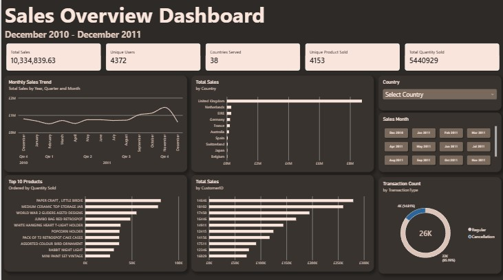
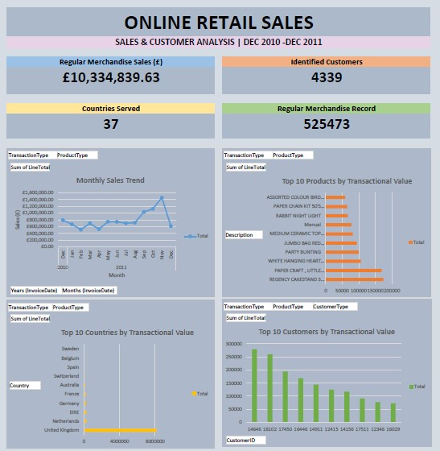

# Online Retail Sales & Customer Analysis

An end-to-end data analytics portfolio project using Excel, SQL (SQLite), and Power BI to analyze sales performance, product demand, geographic contribution, customer purchasing behavior, and transaction data quality.

## Project Overview

The project uses the **Online Retail** dataset from the [UCI Machine Learning Repository](https://archive.ics.uci.edu/dataset/352/online+retail). The original dataset contains 541,909 transaction-line records from 1 December 2010 to 9 December 2011.

A duplicate-reviewed working copy contains **536,641 records**. The original source data was preserved.

### Tools Used

- **Microsoft Excel** — data profiling, cleaning review, calculated columns, PivotTables, exploratory dashboard
- **SQLite / DBeaver** — data validation and analytical SQL queries
- **Microsoft Power BI** — interactive dashboard and DAX measures
- **Git / GitHub** — version control and portfolio presentation

## Business Questions

1. How did merchandise sales change over time?
2. Which products contributed the most revenue and sales volume?
3. Which countries generated the highest merchandise sales?
4. How did customer spending and invoice frequency differ?
5. What data-quality issues and cancellation patterns should be considered when interpreting results?

## Key Findings

### Sales Performance

- Regular merchandise sales totaled **£10,334,839.63** after excluding cancellation transactions and rows classified as non-merchandise.
- November 2011 was the strongest month at **£1,456,607.57**.
- February 2011 was the weakest complete month at **£509,232.52**.
- From October to November, sales increased **29.45%**, units sold increased **26.52%**, and invoice count increased **32.79%**. Average order value declined **2.52%**, suggesting the increase was associated more with higher transaction volume than higher average invoice value.
- December 2011 is incomplete: the dataset ends on 9 December.

### Product Performance

- **Regency Cakestand 3 Tier** was the highest-revenue product at **£174,156.54**.
- **Paper Craft, Little Birdie** was the highest-volume product at **80,995 units** and ranked second in revenue at **£168,469.60**.
- The difference between revenue and quantity rankings shows why product performance should be assessed using both measures.

### Geographic Performance

- The United Kingdom generated **£8,167,128.18**, approximately **79%** of regular merchandise sales.
- The Netherlands, EIRE, Germany, and France were the next largest international markets by revenue.
- International expansion should be evaluated with additional information on margins, shipping costs, customer retention, and market growth.

### Customer Analysis

- Customer purchasing patterns varied considerably.
- Customer 14911 generated 5,672 invoices with average spending of approximately **£25.33 per invoice**.
- Customer 16446 generated **£168,472.50** across three invoices, averaging **£56,157.50 per invoice**.
- Customer 12346 generated **£77,183.60** from one invoice.
- Invoice count and total spending describe different aspects of customer value; invoice dates would be needed to assess repeat-purchase regularity.

### Transaction and Data Quality

- **14.81%** of distinct invoices were classified as cancellations; 85.19% were regular invoices. This is based on `DISTINCTCOUNT(InvoiceNo)` grouped by transaction type, not a count of transaction-line rows.
- The cleaned working dataset contains **135,037 records with missing CustomerID** (approximately 25.16%).
- The initial audit identified 10,624 negative-quantity rows, 2,515 zero-unit-price rows, and two negative-unit-price rows.
- 5,268 exact duplicate rows were removed from the working copy. The original dataset was retained.

## Data Preparation and Methodology

1. Preserved the original source dataset and created a separate working copy.
2. Reviewed missing customer identifiers, negative quantities, unusual unit prices, and exact duplicate rows.
3. Added calculated fields for line total, transaction type, product type, and customer identifier status.
4. Exported the cleaned working copy for SQLite and Power BI.
5. Used SQL aggregations, CTEs, date parsing, and window functions to answer analytical questions.
6. Built an interactive Power BI dashboard with KPI cards, monthly sales, top products, top countries, top customers, transaction mix, and a month slicer.

### Sales Definition

The Power BI sales measure filters to:

- `TransactionType = "Regular"`
- `ProductType = "Merchandise"`

This measure represents regular merchandise sales in the dataset. It should not be interpreted as audited revenue, cash collected, or profit.

## Dashboard

The Power BI dashboard includes:

- Total Sales
- Unique Users
- Countries Served
- Unique Products Sold
- Total Quantity Sold
- Monthly sales trend
- Top 10 products by quantity sold
- Top 10 countries by sales
- Top 10 customers by spending
- Regular versus cancellation invoice mix
- Month slicer
- Country selector



The Excel dashboard includes:

- Regular Merchandise Sales
- Identified Users
- Countries Served
- Regular Merchandise Record
- Monthly sales trend
- Top 10 products by transactional value
- Top 10 countries by transaction value
- Top 10 customers by Transactional Value
- Regular versus cancellation invoice mix
- Month slicer
- Country selector



## Repository Structure

```text
Online-Retail-Sales-Customer-Analysis/
├── README.md
├── data/
│   └── online_retail_cleaned.csv
│   └── Online_Retail_Sales_Analysis.xlsx
├── powerbi/
│   └── Online-Retail-PowerBI-Dashboard.pbix
├── report/
│   └── Online_Retail_Sales_Customer_Analysis_Report.pdf
├── screenshots/
│   └── excel-dashboard.jpg
│   └── powerbi-dashboard.jpg
└── sql/
     └── monthly_sales_analysis.sql
     └── monthly_sales_growth_percentage.sql
     └── top_ten_best_selling_products.sql
     └── top_ten_countries_by_sale_revenues.sql
     └── top_ten_customers.sql


## Limitations

- The dataset covers December 2010 to 9 December 2011 and does not reflect current market conditions.
- December 2011 is incomplete.
- Product cost, shipping cost, and operating expense data are unavailable, so profitability cannot be calculated.
- Missing CustomerIDs limit customer-level analysis.
- Product classification uses description-based rules; some non-standard descriptions may remain classified as merchandise.
- Exact duplicate rows were removed from the working copy, but their presence does not prove that they were erroneous.
- The analysis is descriptive and does not establish causation.

## Dataset Credit

Chen, D. (2015). **Online Retail**. UCI Machine Learning Repository.  
https://doi.org/10.24432/C5BW33

---

*Portfolio project demonstrating an end-to-end analytics workflow using Excel, SQL, and Power BI.*
